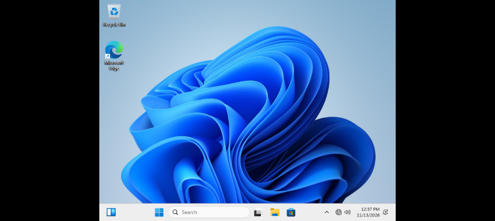
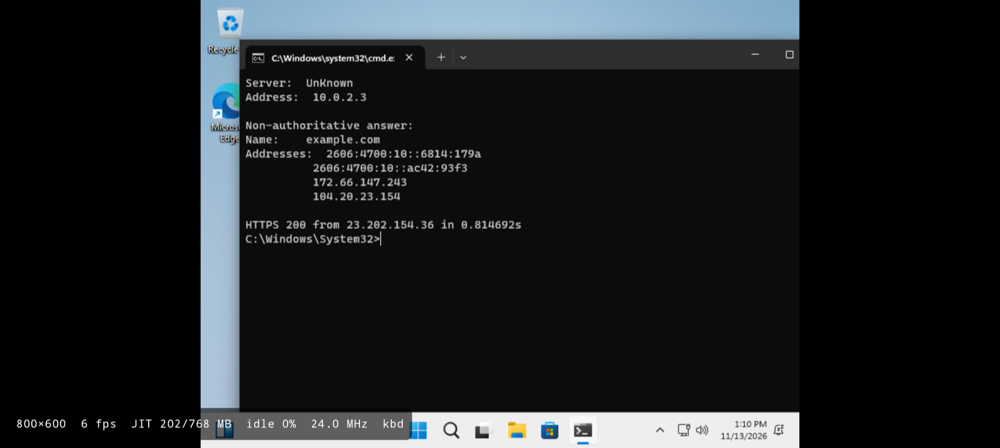
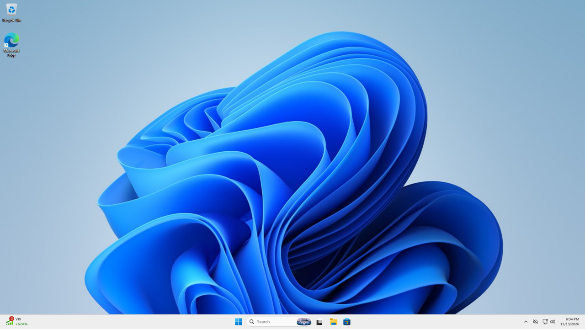
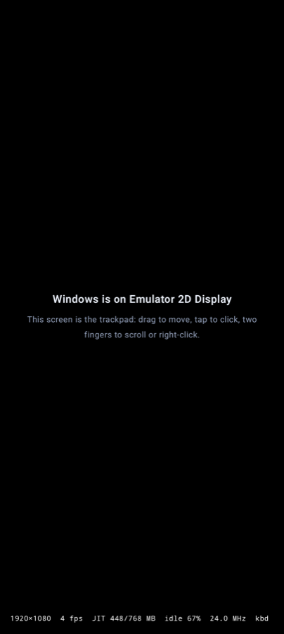

<div align="center">

# WindowsAndroid

**Windows 11 on ARM, running on a high-end Android phone: no hypervisor, no root.**
*Built for the Samsung Galaxy S26 Ultra; meant for any arm64 Android 14+ phone with enough memory (Pixel 10 Pro and up).*

[](LICENSE)
[](#status)
[](docs/ANDROID.md)

</div>

WindowsAndroid runs unmodified Windows 11 24H2 ARM64 inside an Android app.

> **The vision comes from [WindowsiOS](https://github.com/ammaarreshi/WindowsiOS)** by Ammaar
> Reshi: Windows 11 running on an iPhone, with no hypervisor. WindowsAndroid brings that idea,
> and WindowsiOS's engine, to Android phones.

WindowsiOS showed that a phone can run Windows without a hypervisor: an ARM64-to-ARM64 JIT
runs the guest's code at near-native speed under a 4 KB software MMU, on a virtual PC (UEFI,
ACPI, GICv3, PCIe NVMe, USB 3 xHCI, Intel HD Audio, virtio-net) written in C. Android phones expose no hypervisor to
apps either, but they let apps JIT, and that is all the engine needs.

This repository takes WindowsiOS's engine, moves it from Darwin to Linux/Android, and wraps it
in a native Android app. The iOS app and its iPhone-specific tooling are not included; see
[What came from WindowsiOS](#what-came-from-windowsios).

## Status

<table>
  <tr>
    <td width="50%"></td>
    <td width="50%"></td>
  </tr>
  <tr>
    <td align="center"><sub>Windows 11 24H2 ARM64 desktop in the app, ~95 s after tapping Start (arm64 Android 16 emulator, 4 vCPUs, 3.3 GB).</sub></td>
    <td align="center"><sub>DNS and HTTPS from Windows through the app's user-mode network (NetKVM + libslirp).</sub></td>
  </tr>
  <tr>
    <td width="50%"></td>
    <td width="50%" align="center"></td>
  </tr>
  <tr>
    <td align="center"><sub>Plugged into a monitor: Windows full screen at the monitor's 1920×1080 (emulated external display).</sub></td>
    <td align="center"><sub>Meanwhile the phone is the trackpad and keyboard.</sub></td>
  </tr>
</table>

| | |
| :--- | :--- |
| Engine unit tests (JIT, MMU, memory ops, exceptions) | pass on Android 16 (4 KB pages) and Android 17 (16 KB pages) arm64 emulators, and on macOS |
| Windows 11 24H2 ARM64 in the app | boots to the desktop; keyboard (hardware keys and the soft keyboard), touch (trackpad and direct), UAC prompts, network (DHCP, DNS, HTTPS), restart (`shutdown /r`) with the network back afterwards, clean shutdown through the power button |
| External display (portable desktop) | Windows moves to the monitor full screen at its resolution (1920×1080 and 2560×1440 tested) with the phone as trackpad; unplug and replug while running; restart to change size |
| Install from the ISO (in the app) | unattended: USB DVD boot, Setup, restarts, first sign-in, NetKVM and the "done" signal back to the app. Galaxy S26 Ultra: 51 min to the desktop (about half of it with the app in the background, which Android slows down); macOS runner: ~20–23 min (4 vCPUs). Both with an ISO built from Microsoft's ESD, not yet one downloaded from Microsoft's page |
| Provisioning (`scripts/provision_windows_arm64.py`) | Microsoft's ESD to a ready image with the NetKVM network driver in ~16 min on an M-series Mac |
| UEFI firmware (EDK2 ArmVirtQemu, built in) | boots headless from `adb shell` and in the app, on 4 KB and 16 KB page kernels |
| Sound, S Pen, mouse, DeX, shared folder | implemented; not yet exercised (the emulator runs without audio and has no pen) |
| Galaxy S26 Ultra (Snapdragon 8 Elite Gen 5, Android 17) | Windows installed in the app from the ISO and running: desktop, Ethernet (NetKVM) connected, Windows Update reached. Everything else above ran in the arm64 Android emulator on an Apple-silicon Mac, which executes the same arm64 code. Pixel not yet tried |

## The app

- **Installs Windows itself** from Microsoft's Windows 11 Arm64 ISO: pick the ISO, tap Install,
  and Setup runs unattended to the desktop (see [Running Windows](#running-windows)).
- **Full-screen Windows** in landscape (or any shape in DeX / on a large screen), drawn by a GLES
  3 presenter that uploads only what changed and runs at the panel's highest refresh rate.
- **Touch as a trackpad** (drag to move, tap to click, tap-and-drag, two-finger tap for right
  click, two-finger scroll) or **direct touch**, switchable from the command bar.
- **S Pen**: direct pointing with hover; the side button right-clicks.
- **Mice and keyboards** (USB, Bluetooth, Samsung DeX): absolute pointer with all buttons and the
  wheel; keyboards pass through by scan code, so the physical layout just works.
- **Phone keyboard** with an extra-keys row: Esc, Tab, sticky Ctrl/Alt/Shift/Win, arrows,
  Home/End/Del, F1–F12.
- **External displays**: plug the phone into a monitor or TV and Windows moves there, full
  screen at the monitor's resolution, while the phone becomes its trackpad and keyboard: a
  portable desktop. Unplug and it comes back to the phone. (In DeX the app runs on the monitor.)
- **Sound and microphone** through AAudio; **network** through user-mode NAT (libslirp); a
  **shared folder** served over WebDAV at `\\10.0.2.4`.
- Keeps running in the background (foreground service); Back shows and hides the command bar
  instead of leaving Windows.

## Limits

- **Graphics are software-rendered.** The virtual PC has a plain framebuffer, not a GPU, so
  Windows draws everything (DirectX included, through WARP) on the virtual CPUs. The phone's GPU
  only scales and shows the result. Desktop apps and browsing are fine; 3D games are not.
- **Windows' screen size is fixed at boot.** Plugging in a monitor shows Windows there at once;
  filling it at its own resolution takes a restart of Windows (the phone says so).
- **Little time on real phones yet.** Windows has been installed and run on a Galaxy S26 Ultra;
  Pixels, docks, TVs and DeX are untested. The installer has only been fed an ISO built from
  Microsoft's ESD, not yet one downloaded from Microsoft's page.
- **Installing takes a while, and only goes full speed in front.** It took 51 minutes on the
  S26 Ultra, about half of that with the app in the background, where Android gives it a slice
  of one core; with the app on screen the four virtual CPUs each get a core. Keep the app open
  and the phone charging until the desktop appears.
- **Clipboard and links need a Windows-side helper that isn't installed yet.** The app can
  exchange the clipboard with Windows and open links Windows sends it (OAuth and passkey
  sign-in) in the phone's browser, but nothing inside Windows talks to it yet: the link helper
  (`tools/browser_bridge_arm64.c`) is not built or installed by the provisioning, and there is
  no Windows clipboard agent.

## Running Windows

### Install from Microsoft's ISO, on the phone

1. Download **Windows 11 (multi-edition ISO for Arm64)** from
   [microsoft.com/software-download/windows11arm64](https://www.microsoft.com/software-download/windows11arm64)
   to the phone (about 6 GB).
2. Open WindowsAndroid, tap **Choose ISO…** under *Install Windows*, and pick it.
3. Tap **Install Windows**.

Setup then runs by itself: the app attaches the ISO to the virtual PC as a USB DVD drive, adds
a small answer disc of its own, and boots a new, empty disk. Windows Setup installs without
asking anything, restarts a few times, and signs in to the desktop. When it reports that it is
done, the app detaches the discs. The answer file installs Windows 11 Pro in the ISO's language
with a local account (named on the install card, no password, signs in automatically), the
phone's time zone, and the NetKVM network driver. Windows is not activated: you need your own
license. It needs about 25 GB of free space. [docs/ANDROID.md](docs/ANDROID.md) explains how it
works.

### Or provision a disk on a Mac

`scripts/provision_windows_arm64.py` builds the same kind of disk on an Apple-silicon Mac, using
a macOS build of the engine to boot Windows PE and apply Windows from Microsoft's ARM64 ESD:

```bash
brew install qemu wimlib libslirp meson
make -j8 all                                   # build/winvm (macOS runner) and build/hvsparse
# Microsoft's ARM64 ESD, from the Media Creation Tool catalog, at:
#   work/downloads/Win11_24H2_ARM64_en-us.esd
# virtio-win.iso (for the NetKVM network driver), at work/downloads/virtio-win.iso
python3 scripts/provision_windows_arm64.py     # -> work/windows11.img + work/vars.fd
./gradlew :app:installDebug
scripts/android_push_machine.sh - work/vars.fd work/windows11.img   # "-": the built-in firmware
```

The image has a local account `User` with no password that signs in automatically, and the
computer name `WINDOWS-ANDROID`. The disk is streamed to the phone as a sparse container and
expanded there; the files can also be imported from the app's home screen.

The app has its UEFI firmware built in (EDK2 ArmVirtQemu with a patch that lets the app pick
Windows' screen size; `scripts/build_firmware.sh`).

**Memory.** The app offers Windows up to 60% of the phone's RAM: 4.5 GB by default on a 12 GB
phone, 6 GB on a 16 GB S26 Ultra. `scripts/optimize_windows_lite.py`, inherited from WindowsiOS,
strips Windows down further (WindowsiOS measured ~1.5 GB at idle); it has not been run in this
port yet and needs its helper `build/opt_hive_arm64.exe` built from `tools/opt_hive_arm64.c`
with LLVM (clang + lld).

## Building

```bash
scripts/build_android_deps.sh        # once: libffi, glib and libslirp for arm64 Android (guest networking)
./gradlew :app:assembleDebug         # app/build/outputs/apk/debug/app-debug.apk
scripts/build_firmware.sh            # optional: rebuild the bundled UEFI firmware
```

Requirements: Android SDK 37, NDK r30 (30.0.16248370), CMake 4.1.2, JDK 21+ (Android Studio's
bundled JDK works); meson, ninja and pkg-config for the dependencies; `iasl` (Homebrew
`acpica`) for the firmware. Toolchain: AGP 9.5.1, Gradle 9.9.1, Kotlin 2.4.21, Compose BOM
2026.09.00. Without `android-deps/` the engine builds with an unplugged network card instead.

The engine also builds on its own, for running from `adb shell` and for the unit tests:

```bash
scripts/android_test_engine.sh       # cross-build, push and run the core suites on a device/emulator
make test-core                       # the same suites on an Apple-silicon Mac
```

[docs/ANDROID.md](docs/ANDROID.md) covers how the port works, the app's structure, and testing
on the emulator, including a simulated external display.

## Repository layout

```text
WindowsAndroid/
├── app/          # Android app: Kotlin/Compose UI, JNI bridge, GLES presenter, bundled UEFI firmware,
│                 #   ISO installer (answer file, answer disc writer, NetKVM driver)
├── core/         # ARM64->ARM64 JIT, 4 KB software MMU, exceptions, system registers
├── devices/      # UEFI flash, ACPI/SMBIOS, GICv3+ITS, PCIe, NVMe, xHCI (+ USB DVD drives), HD Audio, virtio-net, ramfb
├── host/         # host layer: hv_os (Linux/Android and macOS), JIT memory, entry/exit asm, audio, slirp, WebDAV share
├── guest/        # runs inside Windows: fit-display.ps1 (desktop at the screen's size)
├── scripts/      # Android deps/test/deploy, firmware build, Windows provisioning
├── tests/        # engine unit tests (run on Android and on macOS)
├── tools/        # hvsparse, and Windows-side helpers (hive optimizer, link bridge)
├── docs/         # ANDROID.md: how the port works
├── CMakeLists.txt  # engine build for Linux/Android
└── Makefile      # macOS runner (provisioning) and the unit tests on a Mac
```

## What came from WindowsiOS

WindowsAndroid started as a clone of [WindowsiOS](https://github.com/ammaarreshi/WindowsiOS)
(GPL-2.0-or-later) and keeps its engine: the JIT and MMU in `core/`, the virtual PC in
`devices/`, the host plumbing in `host/`, the unit tests, the provisioning approach and the
Windows-side tools. That engine in turn builds on [Henge](https://github.com/Leviidev/Henge)
and [Husk](https://github.com/Leviidev/Husk).

New here: the Linux/Android host layer (time base, JIT memory, threads, AAudio), the Android
app, the GLES presenter, external-display support with its firmware patch and Windows-side
helper, the in-app ISO installer with its USB DVD drives (USB mass storage, SCSI/MMC), Android builds of the networking dependencies, and the emulator-based test setup.
[docs/ANDROID.md](docs/ANDROID.md) lists the engine changes.

Left out: the iOS app (SwiftUI), its TXM/debugger JIT helpers, iPhone deployment scripts, the
iOS dependency build and the iOS documentation. The macOS command-line runner stays, because
provisioning uses it. Anyone who wants the iPhone version should use WindowsiOS itself.

## Credits

[WindowsiOS](https://github.com/ammaarreshi/WindowsiOS) by Ammaar Reshi, which stands on
[Henge](https://github.com/Leviidev/Henge) and [Husk](https://github.com/Leviidev/Husk);
[libslirp](https://gitlab.freedesktop.org/slirp/libslirp), [GLib](https://gitlab.gnome.org/GNOME/glib),
[EDK2](https://github.com/tianocore/edk2) and
[virtio-win](https://github.com/virtio-win/kvm-guest-drivers-windows). See
[THIRD_PARTY_NOTICES.md](THIRD_PARTY_NOTICES.md).

## License

GNU General Public License v2.0 or later (`GPL-2.0-or-later`), as WindowsiOS. See
[LICENSE](LICENSE). Windows is Microsoft's; you need your own license to use it.
